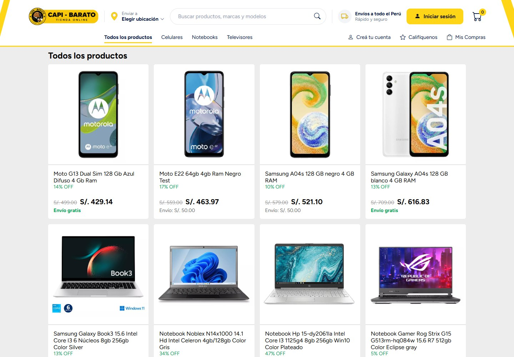
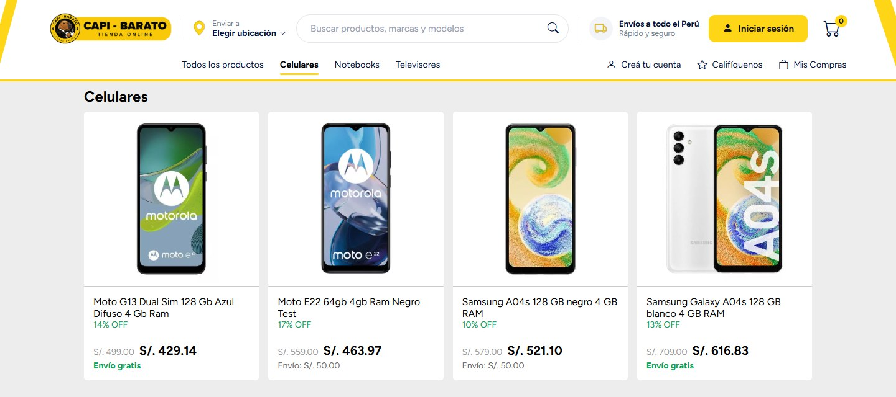
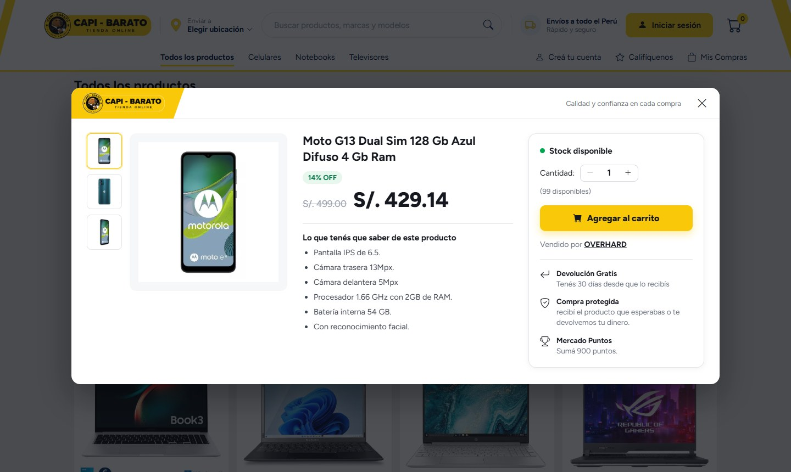
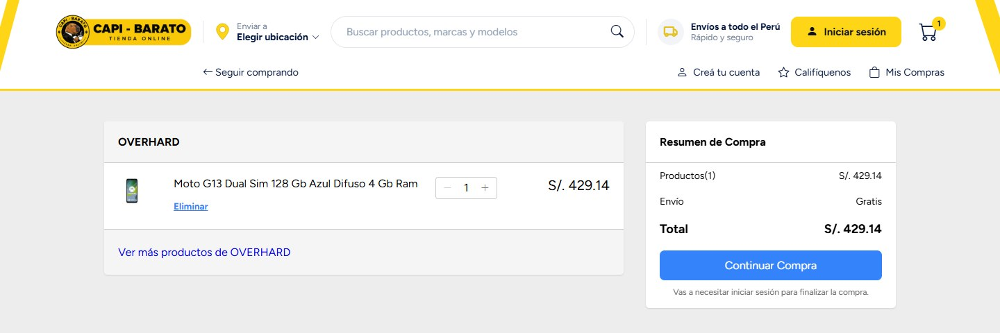
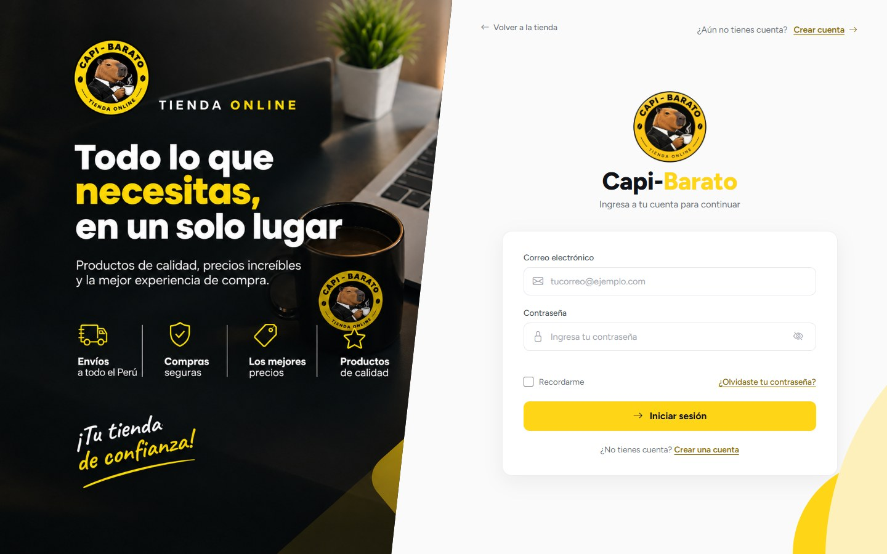
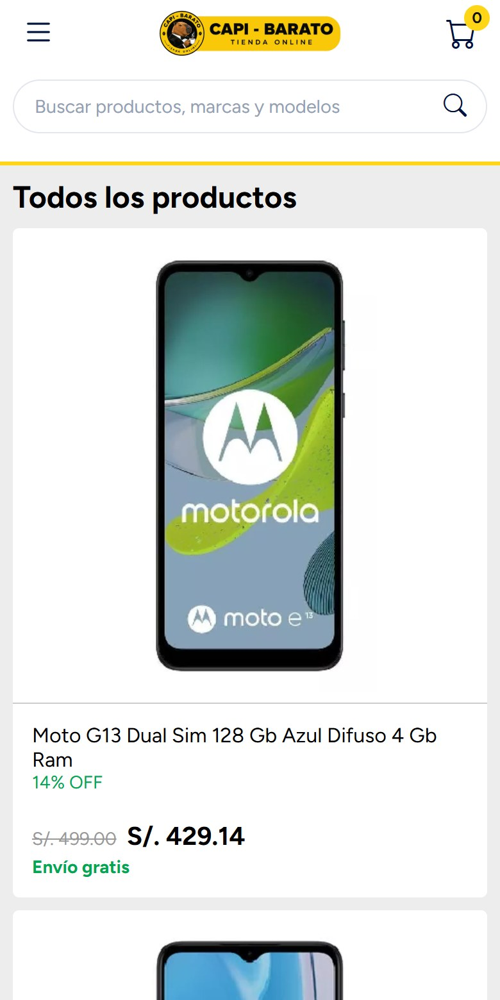
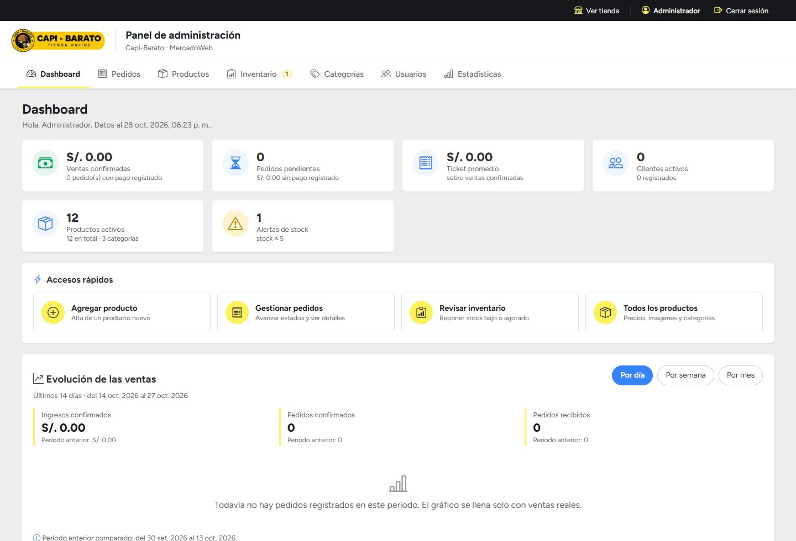
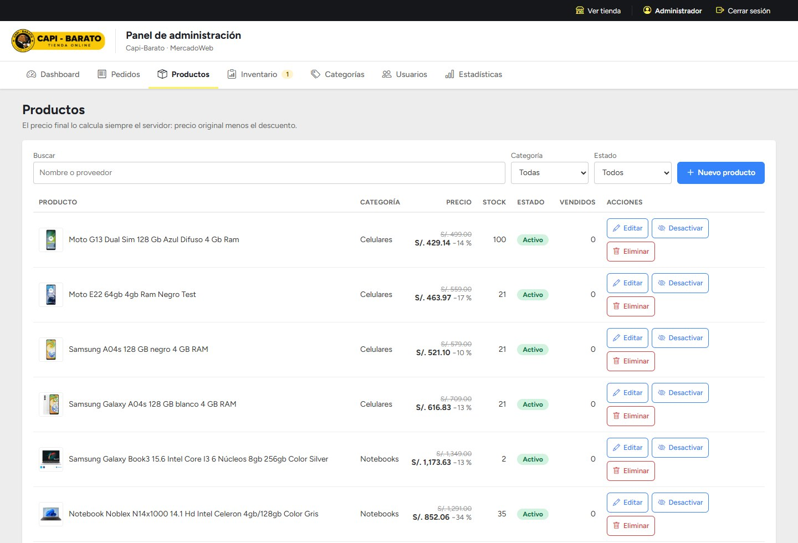

# MercadoWeb — Capi-Barato

Tienda en línea de tecnología (celulares, notebooks y televisores) construida **sin frameworks ni gestores de
paquetes**: HTML, CSS y JavaScript del lado del cliente, PHP 8 con PDO del lado del servidor. **Capi-Barato** es la
marca visible y **MercadoWeb** el nombre técnico del proyecto.

Incluye catálogo dinámico, cuentas de cliente y administrador, carrito de invitado y persistente, checkout
transaccional con control de inventario, historial de compras y un panel administrativo completo.

### 👉 [Ver la tienda publicada](https://web-capi-barato.vercel.app)



---

## Capturas

### Tienda

De la aplicación real en producción, tomadas como visitante no autenticado.

| | |
|---|---|
| **Catálogo filtrado por categoría**<br> | **Detalle de producto**<br> |

**Carrito de compras**



**Inicio de sesión**



**Diseño responsive**



### Panel administrativo

Tomadas sobre una instalación local con los datos de ejemplo del repositorio, para no exponer información de
clientes reales. Por eso los indicadores de ventas aparecen en cero: el panel solo muestra pedidos reales.

**Dashboard**

Indicadores del negocio (ventas confirmadas, pedidos pendientes, ticket promedio, clientes activos, productos y
alertas de stock), accesos rápidos y evolución de ventas por día, semana o mes.



**Gestión de productos**

Listado con buscador y filtros por categoría y estado, precio original y final con el descuento aplicado, stock,
unidades vendidas y las acciones de edición, desactivación y borrado.



---

## Funcionalidades

**Tienda**
- Catálogo dinámico desde la base de datos, con menú de categorías y búsqueda por nombre, categoría o características.
- Detalle de producto con galería de imágenes, precio con descuento, características, stock disponible y proveedor.
- Carrito que funciona sin cuenta (`localStorage`) y se **fusiona** con el carrito del servidor al iniciar sesión.
- Cálculo de envío por pedido: una sola vez, el mayor costo entre los productos con envío pago; gratis si todos lo son.
- Checkout que exige sesión: el servidor recalcula precios y totales y crea el pedido dentro de una transacción,
  descontando stock.
- Historial "Mis Compras" con el precio realmente pagado, que no cambia si después cambia el precio del producto.

**Panel administrativo**
- Dashboard con indicadores reales (ventas, pedidos, stock).
- Pedidos y su ciclo de estados: `pendiente → pagado → enviado → completado`.
- Productos: alta, edición y baja con imágenes y características. Un producto con ventas se **desactiva** en lugar de
  borrarse, para no romper el historial.
- Inventario con alertas de stock bajo y ajustes.
- Categorías, usuarios (activar/desactivar, cambiar rol) y estadísticas.

**Roles**

| Rol | Puede |
|---|---|
| Invitado | Ver el catálogo, buscar, ver detalles y armar un carrito en el navegador. Para comprar debe registrarse o ingresar. |
| Cliente | Todo lo anterior + carrito guardado en la base, checkout, Mis Compras y el detalle de **sus** pedidos. |
| Administrador | Además, el panel completo. |

La autorización se verifica **en el servidor** en cada petición, releyendo rol y estado desde la base. Ocultar
botones en la interfaz es solo cosmético.

---

## Tecnologías

| Capa | Herramientas |
|---|---|
| Frontend | HTML5, CSS3 y JavaScript (ES6+) sin frameworks · Bootstrap Icons 1.11.1 · tipografía Figtree |
| Backend | PHP 8 sin frameworks · PDO · API REST propia (23 endpoints, JSON) |
| Base de datos | MySQL / MariaDB en local · PostgreSQL (Supabase) en producción |
| Almacenamiento | Sistema de archivos en local · Supabase Storage en producción |
| Infraestructura | Vercel (PHP serverless) · Supabase (PostgreSQL + Storage) |
| Pruebas | Bash + curl · Python + Playwright |

Sin `package.json` ni `composer.json`: no hay dependencias de servidor que instalar.

---

## Arquitectura

El mismo código corre en dos entornos. No hay ramas ni archivos distintos: la diferencia se resuelve en
`api/config/entorno.php`, que elige la configuración según lo que encuentre.

```
Navegador  ──►  index.html / carrito.html / admin/ …        (HTML + JS, sin build)
                      │  fetch JSON
                      ▼
               api/*.php   ──►  api/config/entorno.php   ──►  ¿config.php local?
                      │                                        sí → XAMPP + MySQL
                      │                                        no → variables de entorno
                      ▼
            PDO  ──►  MySQL (local)  |  PostgreSQL vía Transaction Pooler (producción)
            Imágenes ──►  img/productos/ (local)  |  Supabase Storage (producción)
```

| | Local | Producción |
|---|---|---|
| Servidor | XAMPP / Apache o `php -S` | Vercel, runtime PHP serverless |
| Base de datos | MySQL / MariaDB | PostgreSQL (Supabase), Transaction Pooler |
| Sesiones | Tabla `sesiones` en la base | Tabla `sesiones` en la base (obligatorio: el disco de Vercel es efímero) |
| Imágenes de productos | `img/productos/` | Supabase Storage (bucket público) |
| Configuración | `api/config/config.php` | Variables de entorno |

Las diferencias de dialecto SQL (identidad autoincremental, `ILIKE` con `unaccent`, `date_trunc`, booleanos
`'t'`/`'f'`) están resueltas en helpers dentro de `api/includes/db.php`, no esparcidas por los endpoints.

---

## Ejecutar en local (XAMPP + MySQL)

**Requisitos**

| Componente | Versión |
|---|---|
| PHP | 8.0 o superior (probado con **8.3**), con `pdo_mysql` y `mbstring` |
| MySQL / MariaDB | MySQL 8.0.16+ o MariaDB 10.2.1+ (probado con **MariaDB 10.11**) |
| Navegador | Cualquiera actual; el sitio se sirve por HTTP, no con `file://` |

**Pasos**

1. Cloná el repositorio donde vayas a servirlo (por ejemplo `C:\xampp\htdocs\`):
   ```bash
   git clone https://github.com/Edwxr320/web-capi-barato.git
   ```
2. Creá la base importando el script. Crea la base `mercadoweb` con **10 tablas**, 3 categorías, 12 productos y el
   usuario administrador:
   ```bash
   mysql -u root -p < sql/mercadoweb.sql
   ```
   En XAMPP también sirve phpMyAdmin → Importar → `sql/mercadoweb.sql`.
3. Configurá la conexión:
   ```bash
   cp api/config/config.example.php api/config/config.php
   ```
   y completá `DB_HOST`, `DB_NAME`, `DB_USER` y `DB_PASS`. `config.php` está en `.gitignore`: **nunca** subas tus
   credenciales.
4. Abrí el sitio:
   - XAMPP / Apache → <http://localhost/Mercadoweb/index.html>
   - Servidor embebido, desde la carpeta del proyecto → `php -S localhost:8080` y entrá a
     <http://localhost:8080/index.html>
5. Panel administrativo: `/admin/index.html`.

Guía detallada para Windows, Linux y macOS: [`docs/INSTALACION.md`](docs/INSTALACION.md).

**Credencial del administrador que crea el script**

`sql/mercadoweb.sql` siembra `admin@capibarato.pe` con la contraseña `CapiBarato2026!`. Es una credencial de
demostración **para tu base local**: no sirve en el sitio publicado, que tiene su propia contraseña. Cambiala apenas
instales. Los clientes se crean desde "Creá tu cuenta".

**Opciones de `api/config/config.php`**

| Constante | Por defecto | Para qué sirve |
|---|---|---|
| `STOCK_BAJO_UMBRAL` | `5` | Un producto queda marcado con "stock bajo" al llegar a este valor o menos |
| `LOGIN_MAX_INTENTOS` / `LOGIN_VENTANA_SEGUNDOS` | `5` / `900` | Bloqueo temporal tras fallos de login (por correo + IP) |
| `SESSION_COOKIE_SECURE` | `false` | Ponelo en `true` si servís por HTTPS |
| `ALMACEN_SESIONES` | `'bd'` | Dónde se guardan las sesiones |
| `ALMACEN_IMAGENES` | `'local'` | `'local'` o `'supabase'` |
| `APP_TZ` | `'America/Lima'` | Zona horaria de la aplicación |

---

## Despliegue (Vercel + Supabase)

El proyecto está publicado en Vercel, con PostgreSQL y Storage en Supabase. En producción no existe
`api/config/config.php`: toda la configuración entra por **variables de entorno**.

| Variable | Para qué |
|---|---|
| `MW_DB_DRIVER` | Motor a usar (`pgsql` en producción) |
| `MW_DB_HOST`, `MW_DB_PORT` | Host y puerto del Transaction Pooler de Supabase |
| `MW_DB_NAME`, `MW_DB_USER`, `MW_DB_PASS` | Credenciales de PostgreSQL |
| `SUPABASE_URL` | URL del proyecto de Supabase |
| `SUPABASE_SERVICE_ROLE_KEY` | Clave secreta de servidor para Storage (admite la clave `sb_secret_…` actual y las `service_role` heredadas) |
| `SUPABASE_BUCKET` | Bucket donde se guardan las imágenes de productos |
| `MW_ALMACEN_IMAGENES`, `MW_ALMACEN_SESIONES` | `supabase` y `bd` en producción |
| `MW_SESSION_COOKIE_SECURE`, `MW_TZ` | Cookies solo por HTTPS y zona horaria |
| `MW_STOCK_BAJO_UMBRAL`, `MW_LOGIN_MAX_INTENTOS`, `MW_LOGIN_VENTANA_SEGUNDOS` | Equivalentes a las constantes locales |

Este repositorio **no contiene** valores de esas variables, ni claves, ni `config.php`, ni archivos `.env`.

El esquema de PostgreSQL y sus datos iniciales están en `supabase/migrations/` (tres migraciones acumulativas: el
esquema, los datos de arranque y el blindaje de la API pública con Row Level Security). El procedimiento completo —
migraciones, verificaciones y puesta en marcha — está en
[`docs/DEPLOYMENT_VERCEL_SUPABASE.md`](docs/DEPLOYMENT_VERCEL_SUPABASE.md).

---

## Pruebas

```bash
bash tests/run_all.sh          # todas las suites
bash tests/run_all.sh bash     # solo las de bash + curl (rápido)
```

Las pruebas **nunca** tocan la base `mercadoweb`: usan una base aislada terminada en `_test`, levantan su propio
servidor PHP y se detienen ante cualquier error de preparación. Las suites de navegador necesitan Playwright
(`pip install playwright` y `python3 -m playwright install chromium`); si falta, se omiten y lo avisan.

La última ejecución registrada (2026-10-24, contra PHP + MariaDB + Chromium) terminó con **853 aserciones aprobadas
y 0 fallidas en 10 suites**. El detalle, aserción por aserción, está en
[`docs/MATRIZ-PRUEBAS.md`](docs/MATRIZ-PRUEBAS.md); los requisitos y qué datos modifica cada suite, en
[`tests/README.md`](tests/README.md).

---

## Seguridad aplicada

- Consultas preparadas con PDO en toda la API.
- Contraseñas con `password_hash` / `password_verify` (bcrypt).
- Sesión HttpOnly, `SameSite=Lax`, modo estricto, regenerada al ingresar y guardada en la base.
- Token CSRF, verificación de `Origin` y cuerpo JSON obligatorio en todo POST.
- Límite de intentos de login por correo + IP, contabilizado en la base de datos.
- Rol y estado del usuario revalidados en cada petición; los pedidos ajenos responden 404.
- Precios, totales y envío calculados en el servidor, nunca tomados del cliente.
- Todo texto escapado en la interfaz; el panel no usa `innerHTML`.
- Subida de imágenes validada por contenido real, no por extensión.
- En PostgreSQL, Row Level Security activa en las 10 tablas y permisos revocados a los roles públicos, para que la
  API REST automática de Supabase no exponga datos.
- `config.php`, claves y archivos `.env` quedan fuera del repositorio.

---

## Estado del proyecto

El sitio está publicado y en funcionamiento. Verificado en producción: el catálogo y el detalle se sirven desde
PostgreSQL, las sesiones se guardan en la base, el inicio de sesión funciona y la subida de imágenes a Supabase
Storage completa el ciclo de alta, lectura pública y borrado.

Es un proyecto **académico y de portafolio**: no tiene pasarela de pagos, y el estado `pagado` lo registra un
administrador desde el panel.

**Limitaciones conocidas**

- Sin pasarela de pagos (decisión de diseño).
- El inventario no guarda historial de movimientos.
- El estado `cancelado` existe en el modelo, pero el panel todavía no permite cancelar: falta definir desde qué
  estados se puede y si se devuelve el stock.
- No hay cambio de contraseña ni alta de usuarios desde el panel.
- Las imágenes que dejan de usarse no se borran automáticamente del almacenamiento.
- Quedan elementos heredados de la maqueta sin función real ("Recordarme", "¿Olvidaste tu contraseña?",
  "Mercado Puntos", "Devolución Gratis").
- Bootstrap Icons y Figtree se cargan desde CDN: sin Internet el sitio funciona, pero sin iconos ni esa tipografía.

El detalle de estas decisiones, con su historia, está en [`docs/CHANGELOG.md`](docs/CHANGELOG.md).

---

## Documentación

| Archivo | Contenido |
|---|---|
| [`docs/INSTALACION.md`](docs/INSTALACION.md) | Instalación detallada en Windows, Linux y macOS |
| [`docs/DEPLOYMENT_VERCEL_SUPABASE.md`](docs/DEPLOYMENT_VERCEL_SUPABASE.md) | Despliegue en Vercel + Supabase, migraciones y verificaciones |
| [`docs/ENDPOINTS.md`](docs/ENDPOINTS.md) | Referencia de la API: parámetros, validaciones y códigos |
| [`docs/MATRIZ-PRUEBAS.md`](docs/MATRIZ-PRUEBAS.md) | Matriz de pruebas con el resultado real de cada aserción |
| [`docs/CHANGELOG.md`](docs/CHANGELOG.md) | Qué se hizo en cada bloque, defectos encontrados y corregidos |
| [`docs/ARCHIVOS.md`](docs/ARCHIVOS.md) | Inventario de archivos del proyecto |
| [`tests/README.md`](tests/README.md) | Cómo correr las pruebas y qué datos toca cada suite |

---

Desarrollado por [Edwxr320](https://github.com/Edwxr320).
